# Gustavo Mota

### Desenvolvedor de IA · agentes, LLMs e backend

Agentes de IA que saem da demo e entram no sistema real.

---

### Sobre

- Na **Stefanini**, aplico LLMs e agentes de IA à modernização de sistemas legados em mainframe: escrevo os PRDs que guiam os agentes na conversão de COBOL, Natural e Adabas para tecnologias atuais.
- Por conta própria, construo a infraestrutura em volta dos modelos: orquestração entre vários LLMs, processos com portões de qualidade, avaliação estatística e deploy com volta automática quando algo falha.
- Só confio no que foi medido: cada projeto abaixo traz o número que prova que funciona e o código aberto para conferir.

---

### Projetos em destaque

<table>
  <tr>
    <td width="50%" valign="top">
      <h4><a href="https://github.com/gustavomot4/hydra-orch">hydra-orch</a>: orquestrador de LLMs</h4>
      
API local compatível com a da OpenAI que distribui pedidos entre Claude, GPT, Gemini e modelos locais. Quando a cota de um acaba, passa o trabalho para o próximo ou retoma do mesmo ponto. <b>568 testes aprovados.</b>

      

        
        
        
      

    </td>
    <td width="50%" valign="top">
      <h4><a href="https://github.com/gustavomot4/ai-project-pipeline">ai-project-pipeline</a>: desenvolvimento com agentes</h4>
      
Processo para levar uma aplicação do zero à entrega com agentes de IA, com portões objetivos e revisão adversarial. <b>98% dos commits rastreáveis</b> num projeto real de 46 commits.

      

        
        
      

    </td>
  </tr>
  <tr>
    <td width="50%" valign="top">
      <h4><a href="https://github.com/gustavomot4/brasileirao-match-predictor">brasileirao-match-predictor</a>: modelo de previsão</h4>
      
Elo, Poisson e ensemble aceitos só depois do backtest walk-forward. <b>Erro de calibração de 1,1%</b>, também validado na Premier League.

      

        
        
        
      

    </td>
    <td width="50%" valign="top">
      <h4><a href="https://github.com/gustavomot4/spo-inventory-management">spo-inventory-management</a>: estoque e vendas</h4>
      
Sistema em uso por uma loja, com CI que publica a imagem e atualização automática que volta para a versão anterior se a nova falhar. <b>84 problemas corrigidos em 14 rodadas de QA.</b>

      

        
        
        
      

    </td>
  </tr>
  <tr>
    <td width="50%" valign="top">
      <h4><a href="https://github.com/gustavomot4/kit-frontend">kit-frontend</a>: interfaces feitas por agentes</h4>
      
Skill para agentes de IA criarem telas com identidade própria e acessibilidade medida por um verificador automático. O meu portfólio foi feito com ele.

      

        
      

    </td>
    <td width="50%" valign="top">
      <h4><a href="https://github.com/gustavomot4/tapgo-v2">tapgo-v2</a>: jogo publicado</h4>
      
Disputa de pênaltis que roda em qualquer celular, sem instalar nada. Conexão direta entre celulares testada em rede móvel real: <b>17 de 17</b>. <a href="https://gustavomot4.github.io/tapgo-v2/">Jogar agora</a>.

      

        
        
      

    </td>
  </tr>
</table>

  <a href="https://gustavomot4.github.io/#projetos">Ver os projetos no portfólio</a> · <a href="https://github.com/gustavomot4?tab=repositories">Todos os repositórios</a>

---

### Tecnologias

---

### Estatísticas

---

### Contato

Procuro uma vaga em engenharia de IA.

